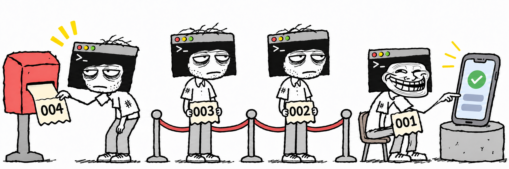

# codex-device-queue

<p align="center">
  <a href="README.md">English</a> | <a href="README.ko.md">한국어</a> | <strong>日本語</strong>
</p>



**複数のCodexセッションによるAndroid・iOSの実機操作が競合しないよう、デバイスごとに共有キューを提供するプラグインです。**

動いているセッションは多いのに、使えるテスト端末は1台しかなく、実機テストの順番を調整するのが面倒だったので作りました。

## 主な機能

- **デバイスごとのキュー**：同じデバイスを使う作業は順番に実行し、異なるデバイスでの作業は並行して進めます。
- **自動登録と待機**：実機テストが必要になると、Codexがキューに登録して自分の順番を待ちます。
- **優先処理**：急ぎの作業を待機キューの先頭に追加できます。すでにデバイスを使用している作業は中断しません。
- **キュー管理スキル**：状態の確認、待機のキャンセル、デバイスの解放、中断したセッションが残したリクエストの整理に対応します。

## 必要なもの

- macOSまたはWindows 10/11
- Python 3.7以降
- 対象のモバイルデバイスを操作する開発・テストツールと権限

開発ツールの例として、AndroidにはAndroid Studio、iOSにはXcodeがあります。

## インストール

ターミナルで次のコマンドを実行します。

```sh
codex plugin marketplace add minseonglove/codex-device-queue
codex plugin add codex-device-queue@codex-device-queue
```

### スキルによる初期化

Codexで`device-queue`スキルを選択し、`--init`オプションで初期化します。

```text
device-queue --init
```

Codexがプラグインに含まれるフックの動作を確認し、`SessionStart`と`SubagentStart`フックを有効化して信頼済みに設定します。

### 手動での初期化

`--init`を使わずに、フックを手動で設定することもできます。

| 環境 | 設定方法 |
| --- | --- |
| CLI | `/hooks`で`codex-device-queue`の`SessionStart`と`SubagentStart`フックを確認し、有効化と信頼設定を行います。 |
| GUI | **Review hooks**または**Settings → Hooks**で`codex-device-queue`の2つのフックを確認し、有効化と信頼設定を行います。 |

## 使い方

インストールと初期化が完了すると、新しいCodexセッションにデバイスの利用ルールが自動で適用されます。Codexが作業中に実機テストが必要だと判断すると、別途依頼しなくてもキューへの登録からデバイスの使用・解放まで進めます。

次のようにテストを直接依頼することもできます。

```text
接続中のスマートフォンで今回の変更をテストして。
```

Codexは対象のデバイスを確認し、次の順序で作業します。

```text
テストの準備 → デバイスのキューに登録 → 順番を待つ → デバイスを使用 → 解放
```

別のセッションがデバイスを使用中なら、解放されるまで待ちます。順番が来るとCodexが作業を続けるため、ユーザーが改めて知らせる必要はありません。

実機を使わずにできるビルドやコード修正は、デバイスを確保する前に行います。アプリのインストール・起動・画面操作・結果の収集など、一連のデバイス作業は使用権を保持したまま行います。

### 利用できるスキル

Codexのスキル選択メニューから選ぶか、次のように普段の言葉で依頼できます。

| スキル | 依頼の例 | 動作 |
| --- | --- | --- |
| `device-queue [--init \| --front]`<br>`--init`：プラグインのフック確認と初期化<br>`--front`：新しい作業を対象デバイスの待機キューの先頭に登録 | 「接続中のスマートフォンでテストして。」 | デバイスの確認から登録・待機・使用・解放まで進めます。 |
| `device-queue-status` | 「デバイスのキューの状態を見せて。」 | デバイスごとに使用中のセッション、待機中の作業、このセッションの待機順を表示します。 |
| `device-queue-cancel` | 「このセッションのデバイス待ちをキャンセルして。」 | このセッションの待機リクエストをキャンセルします。 |
| `device-queue-release` | 「このセッションが使用中のデバイスを解放して。」 | 関連するデバイス作業が終了したことを確認し、デバイスを解放します。 |
| `device-queue-recover` | 「中断したセッションが確保したままのデバイスを解放して。」 | 以前の作業が終了したことを確認し、残っている待機リクエストのキャンセルやデバイスの解放を行います。 |

対象を特定できない場合、Codexがデバイスやリクエストを確認します。待機のキャンセルは、まだデバイスを確保していないリクエストにのみ適用されます。すでに確保したデバイスは、関連する作業を終えてから解放する必要があります。

### 同じモデルのデバイスを複数接続した場合

キューはAndroidの**ADBシリアル番号**、iOSの**UDID**で区別します。Codexが接続デバイスの一覧を取得するツールで確認した値を使うため、同じモデルを複数接続しても、それぞれ独立したキューを使います。

以下は架空のデバイスIDを使った状態表示の例です。

```text
Pixel 8 · ANDROID-EXAMPLE-01
  使用中: 別のセッション — アプリのインストール確認
  待機順 1: このセッション — ログイン画面の確認

Pixel 8 · ANDROID-EXAMPLE-02
  使用中: このセッション — 設定画面の確認
  待機: なし
```

### 急ぎの作業を優先する

優先処理を指定するには、`device-queue`スキルに`--front`オプションを付けます。

```text
device-queue --front 接続中のタブレットで今回の変更をテストして。
```

「このテストは急ぎなので優先して進めて」のように依頼することもできます。

Codexは新しい作業を対象デバイスの待機キューの先頭に追加します。すでにデバイスを使っている作業はそのまま続き、解放されたら優先リクエストに順番が回ります。

```text
変更前: Aが使用中 → Bが待機 → Cが待機
変更後: Aが使用中 → 急ぎの作業Dが待機 → Bが待機 → Cが待機
```

障害対応中である、リリース期限が迫っているといった明確な根拠があれば、Codexが優先処理を選ぶこともあります。根拠が不明確な場合は、登録順に処理します。

登録済みのリクエストを再試行しても順番は変わりません。優先リクエストが複数待機している場合は、最後に先頭へ追加した作業から処理します。

## 作業の中断と復旧

テストの成否にかかわらず、関連するデバイス作業がすべて終わるとデバイスを解放します。作業や子プロセスが残っている間は、使用権を保持します。

セッションが強制終了すると、待機リクエストや占有状態が残ることがあります。その場合は`device-queue-recover`を依頼してください。Codexが以前のセッションのローカル作業とデバイス上の作業が終了したことを確認し、残っている待機リクエストのキャンセルやデバイスの解放を行います。

待ち時間の長さやデバイスの切断だけを理由に、別のセッションが確保しているデバイスを解放することはありません。

## 共有の範囲

キューは、同じCodex設定ディレクトリとプラグインのインストール環境を使うセッション間で共有します。プロジェクト・ブランチ・ワークツリー・プラグインのバージョンが異なっていても、同じデバイスのキューを共有します。

ユーザーがターミナルやIDEから直接実行するデバイス操作コマンドは、自動ではブロックされません。別途起動したツールやデバイス上で動き続けているテストも終了してから、デバイスを解放してください。

終了したチャットや非アクティブなチャットを自動で再開する機能はありません。

## 更新

```sh
codex plugin marketplace upgrade codex-device-queue
codex plugin add codex-device-queue@codex-device-queue
```

更新してもキューの記録は保持されます。更新後は新しいセッションを開始してください。フックが変更された場合は、`device-queue --init`で再度初期化するか、手動で信頼設定を行います。

## アンインストール

すべてのセッションのデバイス作業を終え、待機リクエストをキャンセルし、確保中のデバイスを解放してからアンインストールします。

```sh
codex plugin remove codex-device-queue@codex-device-queue
```

プラグインとキューの記録・ロックファイルがまとめて削除されます。追加のスキル実行やクリーンアップコマンドは不要です。
