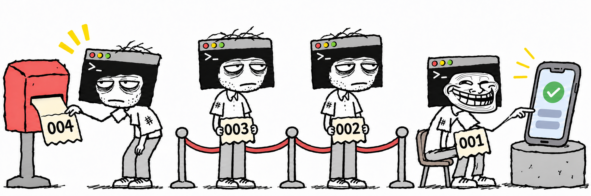

# codex-device-queue

<p align="center">
  <a href="README.md">English</a> | <strong>한국어</strong> | <a href="README.ja.md">日本語</a>
</p>



**여러 Codex 세션이 Android·iOS 모바일 기기를 충돌 없이 사용할 수 있도록, 기기별 공통 대기열을 제공하는 플러그인입니다.**

돌아가고 있는 세션은 많은데 쓸 수 있는 테스트 기기가 하나뿐이라 실기기 테스트를 조율하는 과정이 귀찮아서 만들었습니다.

## 주요 기능

- **기기별 대기열**: 같은 기기를 사용하는 작업은 순서대로 실행하고, 서로 다른 기기의 작업은 동시에 진행합니다.
- **자동 등록과 대기**: 실기기 테스트가 필요하면 Codex가 대기열에 등록하고 자신의 차례를 기다립니다.
- **우선 처리**: 급한 작업을 대기열 맨 앞에 넣을 수 있습니다. 이미 기기를 사용하는 작업은 중단하지 않습니다.
- **대기열 관리 스킬**: 상태 조회, 대기 취소, 기기 반납, 중단된 세션이 남긴 요청 정리를 지원합니다.

## 요구 사항

- macOS 또는 Windows 10/11
- Python 3.7 이상
- 대상 모바일 기기를 제어할 개발·테스트 도구와 권한

개발 도구의 예로 Android는 Android Studio, iOS는 Xcode가 있습니다.

## 설치

터미널에서 다음 명령을 실행합니다.

```sh
codex plugin marketplace add minseonglove/codex-device-queue
codex plugin add codex-device-queue@codex-device-queue
```

### 기본 초기화

Codex에서 `device-queue` 스킬을 선택하고 `--init` 옵션으로 초기화합니다.

```text
device-queue --init
```

Codex가 플러그인 훅의 실행을 확인하고, `SessionStart`와 `SubagentStart` 훅을 활성화한 뒤 신뢰하도록 설정합니다.

### 수동 초기화

기본 초기화 대신 직접 훅을 설정할 수도 있습니다.

| 환경 | 설정 방법 |
| --- | --- |
| CLI | `/hooks`에서 `codex-device-queue`의 `SessionStart`, `SubagentStart` 훅을 확인하고 활성화·신뢰 설정 |
| GUI | **Review hooks** 또는 **Settings → Hooks**에서 `codex-device-queue`의 두 훅을 확인하고 활성화·신뢰 설정 |

## 사용 방법

플러그인 설치와 초기화를 마치면 새 Codex 세션에 기기 사용 규칙이 자동으로 적용됩니다. Codex가 작업 중 실기기 테스트가 필요하다고 판단하면, 사용자가 별도로 요청하지 않아도 대기열 등록부터 기기 사용·반납까지 진행합니다.

다음처럼 테스트를 직접 요청할 수도 있습니다.

```text
연결된 휴대폰에서 이번 변경 사항을 테스트해줘.
```

Codex는 대상 기기를 확인하고 다음 순서로 작업합니다.

```text
테스트 준비 → 기기별 대기열 등록 → 차례 대기 → 기기 사용 → 반납
```

다른 세션이 기기를 사용 중이면 반납할 때까지 기다립니다. 차례가 되면 Codex가 이어서 진행하므로 사용자가 다시 알려줄 필요가 없습니다.

기기가 필요 없는 빌드나 코드 수정은 점유 전에 진행합니다. 앱 설치·실행·화면 조작·결과 수집처럼 이어지는 기기 작업은 한 번의 점유 안에서 처리합니다.

### 제공하는 스킬

Codex의 스킬 선택기에서 선택하거나, 아래처럼 자연어로 요청할 수 있습니다.

| 스킬 | 요청 예시 | 동작 |
| --- | --- | --- |
| `device-queue [--init \| --front]`<br>`--init`: 플러그인 훅 확인 및 초기화<br>`--front`: 새 작업을 해당 기기 대기열 맨 앞에 등록 | “연결된 휴대폰에서 테스트해줘.” | 기기 확인부터 등록·대기·사용·반납까지 진행합니다. |
| `device-queue-status` | “기기 대기열 상태 보여줘.” | 기기별 점유 세션, 대기 작업, 현재 세션의 대기 순서를 보여줍니다. |
| `device-queue-cancel` | “이 세션의 기기 대기를 취소해줘.” | 현재 세션의 대기 요청을 취소합니다. |
| `device-queue-release` | “이 세션이 점유한 기기를 반납해줘.” | 관련 기기 작업이 끝났는지 확인하고 기기를 반납합니다. |
| `device-queue-recover` | “중단된 세션이 남긴 기기 점유를 정리해줘.” | 이전 작업이 끝났는지 확인하고 남은 대기 요청이나 점유를 정리합니다. |

대상을 특정할 수 없으면 Codex가 기기나 요청을 확인합니다. 대기 취소는 아직 기기를 점유하지 않은 요청에만 적용됩니다. 이미 점유한 기기는 관련 작업을 끝낸 뒤 반납해야 합니다.

### 같은 모델의 기기를 여러 대 연결한 경우

대기열은 Android의 **ADB 시리얼 번호**, iOS의 **UDID**를 기준으로 구분합니다. Codex가 기기 조회 도구에서 확인한 값을 사용하므로, 같은 모델의 기기를 여러 대 연결해도 각각 독립된 대기열을 사용합니다.

아래는 가상의 기기 ID를 사용한 상태 표시 예시입니다.

```text
Pixel 8 · ANDROID-EXAMPLE-01
  점유: 다른 세션 — 앱 설치 확인
  대기 1번: 현재 세션 — 로그인 화면 확인

Pixel 8 · ANDROID-EXAMPLE-02
  점유: 현재 세션 — 설정 화면 확인
  대기: 없음
```

### 급한 작업 우선 처리

우선 처리를 지정하려면 `device-queue` 스킬에 `--front` 옵션을 붙입니다.

```text
device-queue --front 연결된 태블릿에서 이번 변경 사항을 테스트해줘.
```

“이 테스트는 급하니까 우선적으로 진행해줘”처럼 자연어로 요청할 수도 있습니다.

Codex는 새 작업을 해당 기기의 대기열 맨 앞에 넣습니다. 이미 기기를 사용하는 작업은 계속 진행하고, 기기를 반납하면 우선 요청이 다음 차례를 받습니다.

```text
기존: A 사용 중 → B 대기 → C 대기
변경: A 사용 중 → 긴급 작업 D 대기 → B 대기 → C 대기
```

실제 장애 대응이나 임박한 배포 일정처럼 명확한 근거가 있으면 Codex가 우선 처리를 판단할 수도 있습니다. 근거가 불분명하면 등록 순서를 따릅니다.

기존 요청을 재시도해도 순서는 바뀌지 않습니다. 대기 중인 우선 요청끼리는 나중에 맨 앞에 등록한 작업이 먼저 처리됩니다.

## 작업 중단과 복구

테스트 성공 여부와 관계없이 관련 기기 작업이 모두 끝나면 기기를 반납합니다. 작업이나 하위 프로세스가 남아 있으면 점유를 유지합니다.

세션이 강제 종료되면 대기 요청이나 점유 기록이 남을 수 있습니다. 이런 경우 `device-queue-recover`를 요청하세요. Codex가 이전 세션의 로컬 작업과 기기에서 진행 중이던 작업이 끝났는지 확인한 뒤 남은 요청을 정리합니다.

오래 기다렸거나 기기 연결이 끊겼다는 이유만으로 다른 세션의 점유를 해제하지는 않습니다.

## 공유 범위

대기열은 같은 Codex 설정 경로와 플러그인 설치 환경을 사용하는 세션끼리 공유합니다. 프로젝트·브랜치·워크트리·플러그인 버전이 달라도 같은 기기의 대기열을 공유합니다.

사용자가 터미널이나 IDE에서 직접 실행하는 기기 명령은 자동으로 차단되지 않습니다. 별도로 실행한 도구나 기기에서 계속되는 테스트도 끝난 뒤 기기를 반납해야 합니다.

종료됐거나 비활성 상태인 채팅을 자동으로 깨우는 기능은 없습니다.

## 업데이트

```sh
codex plugin marketplace upgrade codex-device-queue
codex plugin add codex-device-queue@codex-device-queue
```

업데이트해도 대기열 기록은 유지됩니다. 업데이트 후 새 세션을 시작하세요. 훅이 변경되었다면 `device-queue --init`으로 다시 초기화하거나 수동으로 신뢰 설정을 진행합니다.

## 제거

모든 세션의 기기 작업을 끝내고 대기 요청을 취소한 뒤, 점유한 기기를 반납하고 제거합니다.

```sh
codex plugin remove codex-device-queue@codex-device-queue
```

플러그인과 대기열 기록·잠금 파일이 함께 삭제됩니다. 별도의 스킬 호출이나 정리 명령은 필요하지 않습니다.
