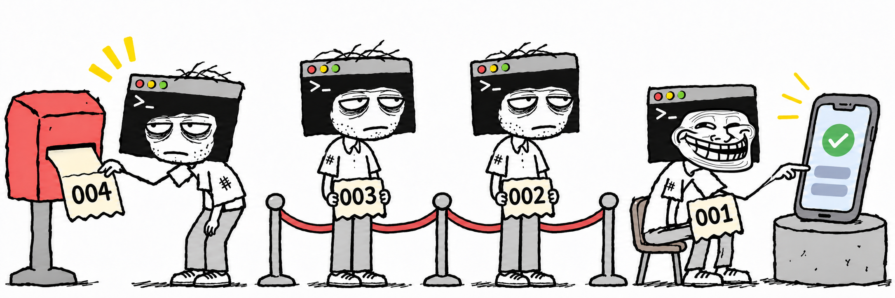

# codex-device-queue

<p align="center">
  <strong>English</strong> | <a href="README.ko.md">한국어</a> | <a href="README.ja.md">日本語</a>
</p>



**A Codex plugin that provides per-device queues so multiple Codex sessions can share physical Android and iOS devices without conflicts.**

I built this because I had many Codex sessions running but only one test device, and coordinating physical-device tests between them was tedious.

## Features

- **Per-device queues**: Tasks using the same device take turns; tasks using different devices can run concurrently.
- **Automatic registration and waiting**: When physical-device testing is needed, Codex joins the queue and waits for its turn.
- **Priority requests**: Urgent work can go to the front of the waiting queue without interrupting the current holder.
- **Queue management skills**: Check status, cancel waiting requests, release devices and clean up requests left by interrupted sessions.

## Requirements

- macOS or Windows 10/11
- Python 3.7 or later
- Tools and permissions needed to develop and test on the target mobile device

Examples include Android Studio for Android and Xcode for iOS.

## Install

Run these commands in a terminal:

```sh
codex plugin marketplace add minseonglove/codex-device-queue
codex plugin add codex-device-queue@codex-device-queue
```

### Default initialization

Select the `device-queue` skill in Codex and pass `--init`:

```text
device-queue --init
```

Codex checks that the plugin's hooks run correctly, then enables and trusts its `SessionStart` and `SubagentStart` hooks.

### Manual initialization

You can also configure the hooks manually instead of using `--init`.

| Interface | Steps |
| --- | --- |
| CLI | In `/hooks`, review, enable and trust the `SessionStart` and `SubagentStart` hooks for `codex-device-queue`. |
| GUI | In **Review hooks** or **Settings > Hooks**, review, enable and trust those two hooks for `codex-device-queue`. |

## Usage

After installation and initialization, new Codex sessions automatically receive the device coordination rules. When Codex determines that physical-device testing is needed, it handles queue registration, device use and release without a separate instruction from you.

You can also request testing directly:

```text
Test this change on the connected phone.
```

Codex identifies the target device and follows this workflow:

```text
Prepare → Join the device queue → Wait for access → Use the device → Release
```

If another session is using the device, Codex waits until it is released, then continues automatically. You do not need to notify Codex when its turn arrives.

Codex completes builds and code changes that do not require the device before acquiring it. It keeps exclusive access throughout app installation, launch, UI interaction and result collection.

### Available skills

Select a skill in Codex's skill picker or request the action in natural language:

| Skill | Example request | Behavior |
| --- | --- | --- |
| `device-queue [--init \| --front]`<br>`--init`: Verify and initialize the plugin hooks.<br>`--front`: Add new work to the front of the device's waiting queue. | "Test this on the connected phone." | Identifies the device, joins the queue, waits, performs the task and releases it. |
| `device-queue-status` | "Show the device queues." | Shows each device's holder, waiting jobs and this session's queue position. |
| `device-queue-cancel` | "Cancel this session's wait for the device." | Cancels this session's waiting request. |
| `device-queue-release` | "Release the device this session holds." | Verifies that device work has ended and releases the device. |
| `device-queue-recover` | "Release the device still held by an interrupted session." | Verifies that the previous work has ended, then cancels the abandoned waiting request or releases the device. |

If the target is unclear, Codex asks which device or request you mean. Cancellation applies only to requests that are still waiting. If a session already holds the device, its associated work must end before release.

### Multiple devices of the same model

Queues use the **ADB serial number** for Android and the **UDID** for iOS. Codex obtains these values from device discovery tools, so devices of the same model have independent queues.

Example status using fictional device IDs:

```text
Pixel 8 · ANDROID-EXAMPLE-01
  Held by: another session — app installation verification
  Waiting 1: this session — login screen verification

Pixel 8 · ANDROID-EXAMPLE-02
  Held by: this session — settings screen verification
  Waiting: none
```

### Urgent work

Add `--front` to the `device-queue` skill to request priority:

```text
device-queue --front Test this change on the connected tablet.
```

You can also ask in natural language: "This test is urgent; prioritize it."

Codex places the new request at the front of that device's waiting queue. The session currently using the device continues uninterrupted; the priority request gets the next turn after release.

```text
Before: A holds the device → B waits → C waits
After:  A holds the device → urgent D waits → B waits → C waits
```

Codex may also choose priority when there is clear evidence, such as an active incident or an imminent release deadline. Otherwise, it follows registration order.

Retrying an existing request does not change its position. When multiple priority requests are waiting, the one most recently added to the front goes first.

## Interruptions and recovery

The device is released after all associated device work ends, whether the test passed or failed. The session keeps exclusive access while related work or subprocesses are still running.

If a session is forcibly terminated, its waiting request or device reservation may remain. Ask Codex to use `device-queue-recover` in that case. It verifies that the previous session's local and device-side work has ended before cancelling the abandoned wait or releasing the device.

A long wait or a device disconnection alone is not enough for Codex to release another session's device.

## Sharing scope

Sessions share queues when they use the same Codex configuration directory and plugin installation. Projects, branches, worktrees and plugin versions can differ while sharing the same device queue.

Device commands you run directly from a terminal or IDE are not automatically blocked. External tools and tests still running on the device must also stop before release.

The plugin does not automatically resume ended or inactive chats.

## Update

```sh
codex plugin marketplace upgrade codex-device-queue
codex plugin add codex-device-queue@codex-device-queue
```

Updates preserve queue records. Start a new session after updating. If the hooks have changed, run `device-queue --init` again or review and trust them manually.

## Remove

Finish device work, cancel waiting requests and release held devices across all sessions before removing the plugin:

```sh
codex plugin remove codex-device-queue@codex-device-queue
```

This removes the plugin, queue records and lock files together. No separate skill or cleanup command is needed.
